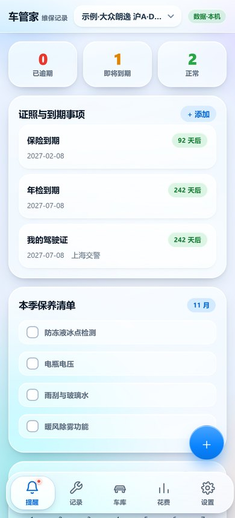
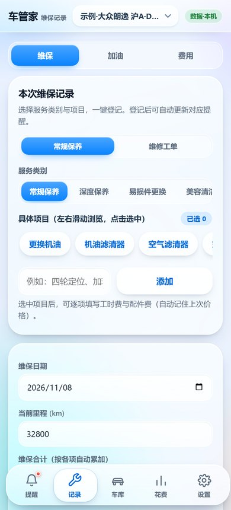
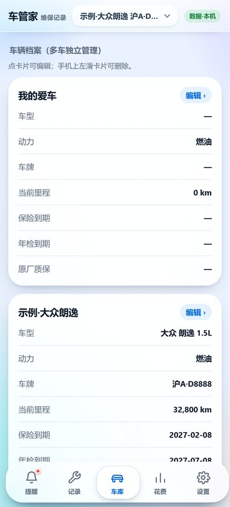
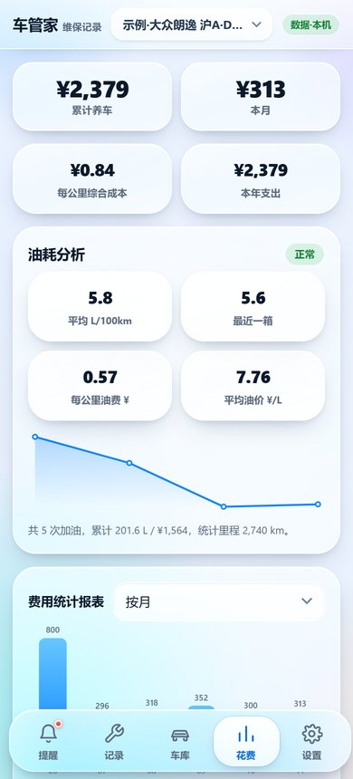
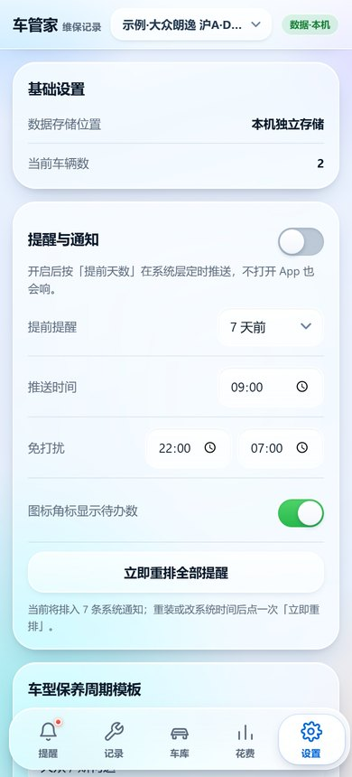

# 车管家 iOS（CarCare）

汽车维修保养记录与智能提醒的 **iOS 原生 App**，功能与安卓版 / PWA 版完全一致。
页面沿用开源项目 [kenowong/car-maintenance](https://github.com/kenowong/car-maintenance) 的离线自包含版（`docs/index.html`，MIT 协议），
外层是原生 iOS 外壳：内置网页通过本机 HTTP 服务加载，浏览器能力由原生桥接实现。

## 界面：iOS 27 Liquid Glass

整站视觉按 iOS 27 的液态玻璃语言重做（只改样式层与图标，业务逻辑一行未动）：

| 元素 | 做法 |
| --- | --- |
| 背景 | 多层柔和光斑墙纸（蓝 / 紫 / 青 / 暖橙径向渐变），给玻璃提供可折射的底层 |
| 卡片 / 弹窗 / 顶栏 | `backdrop-filter: blur(26px) saturate(190%)` + 半透明白渐变 + 1px 高光内描边 + 柔和投影 |
| 底部导航 | 悬浮玻璃胶囊，选中项是白色玻璃「镜头」高亮，图标换成 1.85px 线性 SVG |
| 控件 | 胶囊按钮（主按钮带玻璃高光与彩色投影）、iOS 尺寸开关（51×31）、系统蓝分段控件 |
| 弹窗 | 底部玻璃 sheet，32px 圆角 + 抓取条 + 背景模糊压暗 |
| 动效 | 页面切换 0.3s 弹簧淡入、按压 0.97 缩放，并遵循 `prefers-reduced-motion` |

| 提醒中心 | 记录 | 车库 | 花费 | 设置 |
| --- | --- | --- | --- | --- |
|  |  |  |  |  |

## 2.3.0：从「保养记录本」升级成完整的养车工具

在原有 5 个模块的基础上，补齐了汽车保养 / 维修类应用该有的 19 项能力。

### 数据与账本

| 功能 | 说明 |
| --- | --- |
| 加油记录 + 油耗 | 满箱法算百公里油耗、每公里油费、平均油价，近 12 次油耗趋势曲线，油耗比平均高 25% 自动告警 |
| 证照与到期事项 | 保险、年检、原厂质保、驾驶证、车船税…统一到期看板，逾期 / 30 天内 / 正常三色胶囊 |
| 独立里程打卡 | 不必等保养，随手更新里程；加油 / 维保也会自动写一条，里程不动会导致按里程的提醒失效 |
| 证件文档库 | 行驶证、保单、发票、保养手册拍照归档，按类目 + 到期日管理 |
| 车型保养周期模板 | 大众、丰田、本田、日产、吉利/长安/奇瑞、比亚迪 DM-i、特斯拉纯电，一键写入该车规则 |
| 套餐与储值 | 4S 店三次保养套餐、洗车卡、储值余额，记剩余次数并可「用一次」核销 |

### 车辆健康档案

| 功能 | 说明 |
| --- | --- |
| 轮胎四轮档案 | 车头朝向的四轮图，品牌 / 规格 / DOT 生产周，花纹深度 + 胎压按次记录，低于 3mm 变黄、1.6mm 变红 |
| 配件保修卡 | 换件记保修（月 / 公里），到期前提醒可索赔；维修工单带保修会自动生成一张 |
| 故障灯对照 | 12 种仪表盘警告灯：含义 + 能不能继续开 + 具体处置，红灯标「立即停车」 |
| 症状自查 | 12 类常见故障现象（抖动 / 异响 / 跑偏 / 冒烟 / 顿挫…）→ 可能原因 → 建议排查顺序 |
| 维修工单 | 维保登记可切到「维修工单」：故障现象、检测结论、保修期、修前 / 修后照片、返修标记，项目目录换成发动机 / 变速箱 / 底盘 / 电气 / 空调 / 钣金 |
| 季节保养清单 | 按当前月份自动推 4 条该做的事（入冬查防冻液冰点、梅雨前换雨刮…），可勾选留存 |

### 提醒与统计

| 功能 | 说明 |
| --- | --- |
| 系统级定时通知 | 不再是「打开 App 才检查」：按提前天数算出具体时刻交给系统（iOS `UNCalendarNotificationTrigger` / Android `AlarmManager`），不打开也会响，重启后自动重排 |
| 提前天数 / 推送时间 / 免打扰 | 0、1、3、7、15、30 天可选，时间落在免打扰区间会自动顺延到结束时刻 |
| 到期日历 | 月历上标出每天的到期项，里程类提醒按「日均里程」折算成预计日期，点日期看当天清单 |
| 每公里成本 / 本年支出 | 统计里程用首末里程差，比「累计 ÷ 总里程」更稳 |
| 图标角标 | iOS 角标显示待办数量 |
| 安卓桌面小组件 | 玻璃卡片：下次保养项目 + 还有几天 + 当前里程 + 本月花销，点一下进 App |

### 输出

| 功能 | 说明 |
| --- | --- |
| 车辆履历 PDF | 卖车用：车辆信息、养护维修记录、加油与平均油耗、轮胎、配件保修、费用汇总，一页可直接打印 |
| 语音记账 | 说「加油 300 块」自动填金额并切到加油页；iOS 用 `SFSpeechRecognizer`，安卓用系统 `RecognizerIntent`，语音不上传 |

## 功能对照（与安卓版逐项一致）

| 模块 | 功能 |
| --- | --- |
| 提醒中心 | 逾期/即将到期/正常统计、按车型分组的保养模板气泡、双维度（日期 + 里程）提醒、进度条、编辑 / 已保养顺延 / 删除 |
| 维保服务 | 按动力类型（燃油 / 油电混动 / 插电混动 / 纯电）自动切换服务目录、项目多选、自定义项目、逐项工时费 + 配件费、上次价格记忆、里程自动同步、同名提醒自动顺延 |
| 档案管理 | 多车档案（左滑删除）、车牌省简称 + 号码、VIN、购买日期、保险 / 年检到期自动生成提醒、维保记录列表与凭证缩略图 |
| 成本统计 | 累计 / 本月养车费用、按类别占比、按月 / 按年柱状图、手动记账（油费 / 保险 / 维修 / 停车过路 / 其他） |
| 设置 | 保养规则（按车型自定义周期）、消息推送、导出 CSV、导出 PDF、导入备份、示例数据、清空数据 |
| NAS 同步 | 本机 + NAS 双份存储、服务器地址 + 访问密钥、测试连接 / 立即同步 / 上次同步状态 |

## iOS 侧的原生适配（浏览器版做不到的部分）

| 网页能力 | iOS 实现 |
| --- | --- |
| `localStorage` 持久化 | 内置本机 HTTP 服务（`http://127.0.0.1:48700`）提供正常同源环境，数据存于 WebKit 持久化存储 |
| `confirm` / `alert` / `prompt` | 原生 `UIAlertController`，文案与网页一致 |
| 收据 / 发票凭证上传、导入备份 | WKWebView 原生文件选择面板（相册 / 拍照 / 「文件」），与 Safari 行为一致 |
| 导出 CSV | 截获 `blob:` 下载，写文件后调起系统分享（存到「文件」、发微信、AirDrop 等） |
| 导出 PDF | 离屏渲染生成 PDF，调起系统分享 |
| 查看凭证大图 | 原生全屏图片查看器，可保存 / 分享 |
| 消息推送通知 | `Notification` API 桥接到系统本地通知（前台也会弹出横幅） |
| 安装到主屏卡片 | 隐藏（本身就是独立 App，与安卓 WebView 版处理一致） |
| NAS 局域网访问 | 允许 HTTP 明文与局域网访问（`NSAllowsArbitraryLoadsInWebContent` + 本地网络权限说明） |

## 目录结构

```
CarCare/                  原生源码
  AppDelegate.swift       启动、窗口、本地通知授权
  WebViewController.swift WKWebView 容器 + 全部原生桥接
  LocalHTTPServer.swift   零依赖本地 HTTP 服务（Network.framework）
  PDFExporter.swift       HTML → PDF
  ImagePreviewController.swift  凭证图查看器
Resources/web/            内置网页（index.html / bridge.js / 图标）
tools/                    图标生成、网页资源同步脚本
project.yml               XcodeGen 工程描述
.github/workflows/build-ipa.yml   Actions 出包
```

## 构建

本机无 Mac，统一走 GitHub Actions（macOS 15 + XcodeGen）出 **未签名 IPA**：

```bash
git push origin main      # 自动构建，产物：Actions → carcare-ipa-unsigned
```

## 两种装法（都不需要 Mac）

### 方式一：直接添加到主屏幕（最快，零签名）

iPhone 用 **Safari** 打开 <https://zsonit.github.io/carcare-ios/> → 点「分享」→「添加到主屏幕」。

得到图标独立的 App 体验，Service Worker 首次加载后完全离线可用，数据本地保存。
无需 Apple ID、无需电脑、不会 7 天过期。

### 方式二：装 IPA（真·原生外壳）

`dist/CheGuanJia-iOS-v2.2.0-b5-unsigned.ipa` 是 GitHub Actions 编译出的未签名包。
iOS 强制签名校验，所以需要一个**重签名工具**（Windows 也可以，不需要 Mac）：

1. Windows 装 [Sideloadly](https://sideloadly.io/) 或 爱思助手；
2. 手机数据线连电脑，把 IPA 拖进工具，填自己的 Apple ID；
3. 工具自动签名并安装到手机。

免费 Apple ID 签名 7 天有效，到期重新点一次即可；付费开发者账号 1 年。
装完首次打开需在「设置 → 通用 → VPN与设备管理」里信任证书。

## 网页资源升级

上游页面更新后执行：

```bash
./tools/sync-web.sh /path/to/car-maintenance
```

会把 `docs/index.html`、`manifest.json`、`sw.js`、图标同步进 `Resources/web/`。

## 许可

页面与功能设计来自 kenowong/car-maintenance（MIT）。iOS 外壳代码同样以 MIT 发布。
