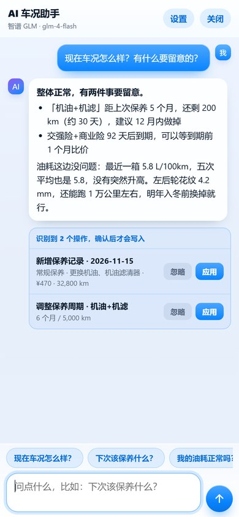

# 车管家 iOS（CarCare）

汽车维修保养记录与智能提醒的 **iOS 原生 App**，功能与安卓版 / PWA 版完全一致。
页面沿用开源项目 [kenowong/car-maintenance](https://github.com/kenowong/car-maintenance) 的离线自包含版（`docs/index.html`，MIT 协议），
外层是原生 iOS 外壳：内置网页通过本机 HTTP 服务加载，浏览器能力由原生桥接实现。

## 界面：iOS 27 Liquid Glass

整站视觉按 iOS 27 的液态玻璃语言重做（只改样式层与图标，业务逻辑一行未动）：

| 元素 | 做法 |
| --- | --- |
| 背景 | 多层柔和光斑墙纸（蓝 / 紫 / 青 / 暖橙径向渐变），给玻璃提供可折射的底层 |
| 卡片 / 弹窗 / 顶栏 | `backdrop-filter: blur(26px) saturate(190%)` + 半透明白渐变 + 1px 高光内描边 + 柔和投影 |
| 底部导航 | 悬浮玻璃胶囊，选中项是白色玻璃「镜头」高亮，图标换成 1.85px 线性 SVG |
| 控件 | 胶囊按钮（主按钮带玻璃高光与彩色投影）、iOS 尺寸开关（51×31）、系统蓝分段控件 |
| 弹窗 | 底部玻璃 sheet，32px 圆角 + 抓取条 + 背景模糊压暗 |
| 动效 | 页面切换 0.3s 弹簧淡入、按压 0.97 缩放，并遵循 `prefers-reduced-motion` |

| 提醒中心 | 记录 | 车库 | 花费 | 设置 |
| --- | --- | --- | --- | --- |
|  |  |  |  |  |

| AI 车况助手 |
| --- |
|  |

## 2.7.0：油价接真实数据 + 定位附近加油站

- 城市油价改为调用公开调价数据接口（免密钥），展示最近一次国家调价后的 92/95/98/89号汽油与0号柴油价格及涨跌幅度、调价日期；接口异常自动回退 AI 估算
- 新增「📍 定位附近加油站」：原生单次定位（iOS CoreLocation / Android LocationManager，运行时权限），跳转高德地图查看附近加油站实时挂牌价，并自动识别所在省份查询本省油价（识别失败不影响看地图）
- 新增原生 httpGet 桥（URLSession / HttpURLConnection），App 内第三方公开接口请求不再受 WebView 跨域限制；浏览器版自动降级为 fetch
- iOS 新增定位权限说明；Android 新增 ACCESS_FINE/COARSE_LOCATION 权限

## 2.6.9：估价逻辑修正（防虚高）

- 系统提示词重写：要求按真实成交行情（懂车帝/二手车之家/瓜子同车型在售价）定价，严禁按新车指导价机械折旧；明确收购价=零售行情7~8成、8年以上家用车成交价通常为新车价15%~25%、老车1万托底等市场常识，宁低勿高
- 新增本地折旧基准：填了购车价后，按车龄折旧曲线+年均里程+车况系数算出客观锚点，写进请求约束模型（收购价在基准0.9~1.5倍、零售不超1.8倍）
- 低里程（年均不足1万公里）自动小幅上浮；纯电车8年以上额外折减电池残值

## 2.6.8：品牌车系表补全老车型

车系对照表从 705 扩充到 926 个（115 个品牌）：大批量补入 2005~2015 年代的老车——丰田花冠/皇冠/锐志、大众老捷达/桑塔纳志俊、本田歌诗图/杰德、雪佛兰乐风/景程、起亚赛拉图、奇瑞旗云、比亚迪F0/F3、吉利自由舰/金刚等；新增夏利、中华、力帆、北汽、北汽新能源、欧宝、道奇、长城轿车等 13 个老品牌。

## 2.6.7：品牌车型级联选择

卖车表单内置 102 个品牌、705 个车系对照表（合资/进口/自主全覆盖，含新能源品牌），品牌→车型改为级联下拉：选品牌后车型列表自动切换；列表没有的小众品牌可选「其他品牌」手动输入车型。颜色扩充到 18 种（含珍珠白、香槟金等）；所有下拉框带箭头指示。

## 2.6.6：AI卖车助手全新表单

「AI旧车估价」升级为「AI卖车助手」，对标主流卖车平台的表单结构：蓝色竖条分组标签（品牌车型年款 / 上牌时间里程城市 / 颜色能源版本 / 车况 / 购车价购车时间），省份下拉 + 市区输入，颜色与能源下拉，购车价（万元）与购车年份选填。估值输出改为「车商收购价」和「零售成交价」双口径。

## 2.6.5：AI选车增加座位布局

座位数下方新增「座位布局」chip（不限 / 2+3 / 2+2+2 / 2+2+3 / 2+3+2），附一句布局说明（2+2+3 为中排独立座椅、MPV 常见；2+3+2 为中排联排、7 座 SUV 常见）。布局与座位数双向联动：点布局自动带出对应座位数，改座位数时会把不兼容的布局重置为「不限」。选中的布局会写进 AI 请求，system 提示也要求按布局形态推荐并说明第三排可用性。

## 2.6.4：图标全新设计「盾 · 光」

彻底重绘：哑光黑曜石底 + 香槟金细边玻璃盾徽，盾内以「透视道路指向灯点」寓意照亮前路——不再放入整车剪影，靠留白与材质对比表达高级感。

## 2.6.3：AI选车增加座位数选项

选车表单在车型与用途之间新增「座位数」chip（不限/5座/6座/7座及以上），推荐结果会考虑座位需求。

## 2.6.2：修复服务弹层选项按钮无法点选

AI选车、AI旧车估价等弹层里的选项 chip（能源/车型/用途/车况）此前没有绑定点击事件，现统一修复，所有弹层选项均可正常点选。

## 2.6.1：修复键盘切换键误触发语音

修复 AI 对话页右侧圆钮在语音模式下按下会误启动语音识别的问题——现在点它只切换语音/键盘输入；文字模式下轻点麦克风则直接切回语音大胶囊。

## 2.6.0：服务中心 + AI 对话页全面改版

新增「服务」标签页，八个用车服务一步直达；AI 对话页改成欢迎页形态。

**服务页（新增标签）**

| 服务 | 说明 |
| --- | --- |
| 城市油价 | 选城市，AI 给出 92/95/98/柴油参考价 |
| 智能提醒 | 本机自动盯保险、年检、保养、驾驶证到期，可让 AI 分析风险 |
| 报告解读 | 拍照或粘贴保养单据/检测报告，AI 逐项解读 |
| AI 选车 | 预算/能源/车型/用途问卷，AI 推荐 3 款并给理由 |
| AI 旧车估价 | 车型/年份/里程/车况，AI 给估值区间与卖车建议 |
| 拍照问AI | 拍下故障灯、异常部位，AI 看图解答 |
| 极速救援 | 122 / 12122 / 120 / 114 一键调起拨号盘 |
| AI 写手 | 一键生成事故处理报告、行车总结、年度用车报告 |

**AI 对话页**：新增绑定车辆提示条、机器人欢迎页与「你可以这样问」建议问题、
「依车作答」开关（关掉后只做通用回答，不带车辆数据）、语音/键盘一键切换、
「⊕」快进拍照问AI 与报告解读。

拍照问AI / 报告解读需要模型支持视觉（看图）能力，如 GLM-4V、豆包视觉版、GPT-4o、Gemini。

## 2.5.1：全新图标

图标整体重绘，更贴近 iOS 27 液态玻璃质感：黑曜石深蓝底、更通透的现代徽章玻璃盾、
极简银白车侧影、底部一道琥珀金光弧——删掉了原来略显卡通的正面车剪影和金色油滴，
配色更克制（黑 + 银 + 一点金），小尺寸下也更清晰。

## 2.5.0：按住说话，直接和 AI 对话

不用打字了：对话页输入栏新增麦克风，**按住说话、松开就把话发给模型**，
说话时实时显示识别文字，手指上滑松开即取消；文字输入原样保留，两种方式随意切。

| 能力 | 说明 |
| --- | --- |
| 按住说话 | 系统级语音识别（离线可用），边说边出字，松开自动发送 |
| 上滑取消 | 说着不要了，手指往上一滑松手即取消，不会误发 |
| 最长 30 秒 | 超时自动按松开处理，不会一直录着 |
| 网页版同步 | GitHub Pages 网页版同样可用（浏览器支持 Web Speech API 时），不支持的环境自动隐藏麦克风 |
| 隐私 | 识别在本机完成，录音不上传、不保存 |

## 2.4.0：内置 AI 车况助手（读得到全部记录，也动手记账）

把一个大模型接进了 App。它看得到这台车的每一条数据，能回答车况问题、给保养建议，
也能按你说的一句话直接把记录写进去。

| 能力 | 说明 |
| --- | --- |
| 全量数据上下文 | 每次提问自动把当前车辆压成一段紧凑 JSON 交给模型：车辆信息、保养提醒及剩余公里 / 天数、最近 20 条维保、最近 10 次加油与油耗统计、轮胎花纹与胎压、配件保修、证照到期、费用汇总、套餐余额。模型不用猜，也不用你复述 |
| 车况问诊 | 「现在车况怎么样」「下次该保养什么」「油耗正常吗」→ 先给结论，再给具体数字（还剩多少公里、多少天、上次多少），发现异常主动点出风险 |
| 动手记账 | 说「昨天加满 313 块 95 号」「把机油改成 6 个月」，模型返回结构化动作，App 渲染成确认卡片，**点「应用」才真正写库**，不会偷偷改你的账 |
| 可执行动作 | 新增保养 / 维修工单、加油、其它费用、里程打卡、改保养周期、标记某项保养已完成、更新车辆信息、跳转页面 |
| 流式输出 | 请求走原生代发，SSE 逐字显示，不用等整段生成完 |
| 免费可用 | 内置 7 家 OpenAI 兼容服务商预设，默认**智谱 GLM-4-Flash（长期免费、国内直连）**；模型名与接口地址都可改，自建网关 / 中转也能接 |
| 离线兜底 | 没配 Key 也能用：首页卡的「本地体检」按规则算出最紧要的提醒、油耗与最近一次到店，纯本地计算 |
| 隐私 | API Key 只存这台手机（独立存储，不进数据备份、不上传任何服务器）；对话记录同样只在本机 |

### 支持的服务商（都走 OpenAI 兼容协议，只换地址与模型名）

| 预设 | 默认模型 | 免费情况（以各家控制台为准） |
| --- | --- | --- |
| 智谱 GLM | `glm-4-flash` | GLM-4-Flash 长期免费，国内直连，额度够个人日常用 |
| 硅基流动 | `Qwen/Qwen3-8B` | 十余个小模型永久免费，国内直连 |
| 火山方舟（豆包） | `doubao-lite-32k` | Lite 每日免费额度较大；模型名要填控制台里的接入点 ID |
| DeepSeek | `deepseek-chat` | 不免费但极便宜（百万 token 几毛钱） |
| Groq | `llama-3.3-70b-versatile` | 免费开发者层，需能访问境外网络 |
| OpenRouter | `deepseek/deepseek-chat-v3.1:free` | 带 `:free` 后缀的模型每天有免费次数 |
| Google Gemini | `gemini-2.5-flash` | AI Studio 免费层，需能访问境外网络 |
| 自定义 | — | 任何兼容 `/chat/completions` 的地址 |

### 为什么大模型请求要绕道原生

WebView 里直接 `fetch` 大模型 API 会被 **CORS** 拦死（服务端不返回 `Access-Control-Allow-Origin`）。
所以网页只负责组装请求，实际发送交给原生：

```
网页 cc-ai.js  ──{type:'ai',url,headers,body}──▶  iOS AIClient / Android AIHttp
                                                        │  URLSession / HttpURLConnection
                                                        ▼
                                              边收边回吐 ccAiChunk(id,text)
网页解析 SSE 的 data: 行，逐字渲染 ◀──────────────────────────┘
```

## 2.3.0：从「保养记录本」升级成完整的养车工具

在原有 5 个模块的基础上，补齐了汽车保养 / 维修类应用该有的 19 项能力。

### 数据与账本

| 功能 | 说明 |
| --- | --- |
| 加油记录 + 油耗 | 满箱法算百公里油耗、每公里油费、平均油价，近 12 次油耗趋势曲线，油耗比平均高 25% 自动告警 |
| 证照与到期事项 | 保险、年检、原厂质保、驾驶证、车船税…统一到期看板，逾期 / 30 天内 / 正常三色胶囊 |
| 独立里程打卡 | 不必等保养，随手更新里程；加油 / 维保也会自动写一条，里程不动会导致按里程的提醒失效 |
| 证件文档库 | 行驶证、保单、发票、保养手册拍照归档，按类目 + 到期日管理 |
| 车型保养周期模板 | 大众、丰田、本田、日产、吉利/长安/奇瑞、比亚迪 DM-i、特斯拉纯电，一键写入该车规则 |
| 套餐与储值 | 4S 店三次保养套餐、洗车卡、储值余额，记剩余次数并可「用一次」核销 |

### 车辆健康档案

| 功能 | 说明 |
| --- | --- |
| 轮胎四轮档案 | 车头朝向的四轮图，品牌 / 规格 / DOT 生产周，花纹深度 + 胎压按次记录，低于 3mm 变黄、1.6mm 变红 |
| 配件保修卡 | 换件记保修（月 / 公里），到期前提醒可索赔；维修工单带保修会自动生成一张 |
| 故障灯对照 | 12 种仪表盘警告灯：含义 + 能不能继续开 + 具体处置，红灯标「立即停车」 |
| 症状自查 | 12 类常见故障现象（抖动 / 异响 / 跑偏 / 冒烟 / 顿挫…）→ 可能原因 → 建议排查顺序 |
| 维修工单 | 维保登记可切到「维修工单」：故障现象、检测结论、保修期、修前 / 修后照片、返修标记，项目目录换成发动机 / 变速箱 / 底盘 / 电气 / 空调 / 钣金 |
| 季节保养清单 | 按当前月份自动推 4 条该做的事（入冬查防冻液冰点、梅雨前换雨刮…），可勾选留存 |

### 提醒与统计

| 功能 | 说明 |
| --- | --- |
| 系统级定时通知 | 不再是「打开 App 才检查」：按提前天数算出具体时刻交给系统（iOS `UNCalendarNotificationTrigger` / Android `AlarmManager`），不打开也会响，重启后自动重排 |
| 提前天数 / 推送时间 / 免打扰 | 0、1、3、7、15、30 天可选，时间落在免打扰区间会自动顺延到结束时刻 |
| 到期日历 | 月历上标出每天的到期项，里程类提醒按「日均里程」折算成预计日期，点日期看当天清单 |
| 每公里成本 / 本年支出 | 统计里程用首末里程差，比「累计 ÷ 总里程」更稳 |
| 图标角标 | iOS 角标显示待办数量 |
| 安卓桌面小组件 | 玻璃卡片：下次保养项目 + 还有几天 + 当前里程 + 本月花销，点一下进 App |

### 输出

| 功能 | 说明 |
| --- | --- |
| 车辆履历 PDF | 卖车用：车辆信息、养护维修记录、加油与平均油耗、轮胎、配件保修、费用汇总，一页可直接打印 |
| 语音记账 | 说「加油 300 块」自动填金额并切到加油页；iOS 用 `SFSpeechRecognizer`，安卓用系统 `RecognizerIntent`，语音不上传 |

## 功能对照（与安卓版逐项一致）

| 模块 | 功能 |
| --- | --- |
| 提醒中心 | 逾期/即将到期/正常统计、按车型分组的保养模板气泡、双维度（日期 + 里程）提醒、进度条、编辑 / 已保养顺延 / 删除 |
| 维保服务 | 按动力类型（燃油 / 油电混动 / 插电混动 / 纯电）自动切换服务目录、项目多选、自定义项目、逐项工时费 + 配件费、上次价格记忆、里程自动同步、同名提醒自动顺延 |
| 档案管理 | 多车档案（左滑删除）、车牌省简称 + 号码、VIN、购买日期、保险 / 年检到期自动生成提醒、维保记录列表与凭证缩略图 |
| 成本统计 | 累计 / 本月养车费用、按类别占比、按月 / 按年柱状图、手动记账（油费 / 保险 / 维修 / 停车过路 / 其他） |
| 设置 | 保养规则（按车型自定义周期）、消息推送、导出 CSV、导出 PDF、导入备份、示例数据、清空数据 |
| NAS 同步 | 本机 + NAS 双份存储、服务器地址 + 访问密钥、测试连接 / 立即同步 / 上次同步状态 |
| AI 车况助手 | 全量记录作为上下文问诊、流式回答、可执行动作（确认后写库）、7 家服务商预设 + 自定义地址、离线本地体检 |

## iOS 侧的原生适配（浏览器版做不到的部分）

| 网页能力 | iOS 实现 |
| --- | --- |
| `localStorage` 持久化 | 内置本机 HTTP 服务（`http://127.0.0.1:48700`）提供正常同源环境，数据存于 WebKit 持久化存储 |
| `confirm` / `alert` / `prompt` | 原生 `UIAlertController`，文案与网页一致 |
| 收据 / 发票凭证上传、导入备份 | WKWebView 原生文件选择面板（相册 / 拍照 / 「文件」），与 Safari 行为一致 |
| 导出 CSV | 截获 `blob:` 下载，写文件后调起系统分享（存到「文件」、发微信、AirDrop 等） |
| 导出 PDF | 离屏渲染生成 PDF，调起系统分享 |
| 查看凭证大图 | 原生全屏图片查看器，可保存 / 分享 |
| 消息推送通知 | `Notification` API 桥接到系统本地通知（前台也会弹出横幅） |
| 安装到主屏卡片 | 隐藏（本身就是独立 App，与安卓 WebView 版处理一致） |
| NAS 局域网访问 | 允许 HTTP 明文与局域网访问（`NSAllowsArbitraryLoadsInWebContent` + 本地网络权限说明） |
| 大模型 API（CORS） | 网页直连会被跨域拦死，改由 `AIClient` 用 `URLSession.bytes` 代发 + 流式回吐 `ccAiChunk` |

## 目录结构

```
CarCare/                  原生源码
  AppDelegate.swift       启动、窗口、本地通知授权
  WebViewController.swift WKWebView 容器 + 全部原生桥接
  AIClient.swift          大模型请求代发（URLSession 流式 + 增量回吐）
  LocalHTTPServer.swift   零依赖本地 HTTP 服务（Network.framework）
  PDFExporter.swift       HTML → PDF
  ImagePreviewController.swift  凭证图查看器
Resources/web/            内置网页（index.html / bridge.js / cc-ext.js / cc-ai.js / 图标）
tools/                    图标生成、网页资源同步脚本
project.yml               XcodeGen 工程描述
.github/workflows/build-ipa.yml   Actions 出包
```

## 构建

本机无 Mac，统一走 GitHub Actions（macOS 15 + XcodeGen）出 **未签名 IPA**：

```bash
git push origin main      # 自动构建，产物：Actions → carcare-ipa-unsigned
```

## 两种装法（都不需要 Mac）

### 方式一：直接添加到主屏幕（最快，零签名）

iPhone 用 **Safari** 打开 <https://zsonit.github.io/carcare-ios/> → 点「分享」→「添加到主屏幕」。

得到图标独立的 App 体验，Service Worker 首次加载后完全离线可用，数据本地保存。
无需 Apple ID、无需电脑、不会 7 天过期。

### 方式二：装 IPA（真·原生外壳）

**正式发布版（iOS + Android 双端安装包都在这一个地址）：[https://github.com/zsonit/carcare-ios/releases/latest](https://github.com/zsonit/carcare-ios/releases/latest)。**

`dist/CheGuanJia-iOS-v2.6.4-15-unsigned.ipa` 是 GitHub Actions 编译出的未签名包。
iOS 强制签名校验，所以需要一个**重签名工具**（Windows 也可以，不需要 Mac）：

1. Windows 装 [Sideloadly](https://sideloadly.io/) 或 爱思助手；
2. 手机数据线连电脑，把 IPA 拖进工具，填自己的 Apple ID；
3. 工具自动签名并安装到手机。

免费 Apple ID 签名 7 天有效，到期重新点一次即可；付费开发者账号 1 年。
装完首次打开需在「设置 → 通用 → VPN与设备管理」里信任证书。

## 网页资源升级

上游页面更新后执行：

```bash
./tools/sync-web.sh /path/to/car-maintenance
```

会把 `docs/index.html`、`manifest.json`、`sw.js`、图标同步进 `Resources/web/`。

## 许可

页面与功能设计来自 kenowong/car-maintenance（MIT）。iOS 外壳代码同样以 MIT 发布。
